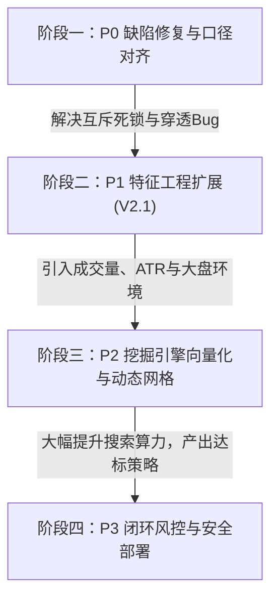

# 量化特征提取与再挖掘策略系统优化方案 (V2.1)

> **文档状态**：针对系统最新 V2.0 特征提取、因果前驱挖掘、防过拟合检验及实盘撮合链路的深度体检与全面优化方案。  
> **审查版本**：`src/features.ts` (v2.0.0)、`scripts/mine-strategy.ts`、`scripts/deploy-strategy.ts`、`src/paper-trading.ts`、`reports/strategy-mining-report.md`。

---

## 一、系统现状全面审查与体检结论

系统在 V2.0 中重构了端到端的量化挖掘流水线，建立了从**阶段 0 客观因果前驱挖掘**到**特征向量化提取**、**三段式样本隔离**、**参数高原稳健性打分**及**组合并发资产模拟**的完整框架。

### 1.1 系统已具备的核心优势
1. **统一特征计算层 (`src/features.ts`)**：
   - 彻底消除了回测引擎与实盘引擎各自为政的双重 switch 判定，统一由 `computeFeatureVector()` 提取标准化 `FeatureVector`，并由 `evaluateFeatureSpec()` 统一评估规则。
   - 严格实现了 **M3 Warmup Consistency**，统一截取最近 500 根 1m 已收盘 K 线作为指标计算窗口，实测浮点误差 $< 10^{-9}$。
2. **防过拟合多重防护机制**：
   - **时间序列三段严格切分**：60% 训练集、20% 验证集、20% 留出测试集（Holdout），全流程零未来函数。
   - **Walk-Forward 滚动验证**：4 组滚动折叠窗口，确保策略具备跨时间切片的可持续性。
   - **参数稳健性高原打分 (Neighbor Robustness Score)**：以策略自身得分与邻近参数空间网格的均值融合打分（各占 50%），严防单点过拟合孤峰。
   - **保守撮合仿真 (D6)**：同一分钟 K 线同时触碰 TP 与 SL 时默认先判止损，止损按极端价成交，入场叠加滑点，并对齐 0.2% 保本保护。
3. **全流程闭环部署**：
   - `scripts/deploy-strategy.ts` 具备特征版本校验（`v2.0.0`）与严格部署门槛拦截机制，防止劣质参数直接上线。

---

### 1.2 实际挖掘体检诊断：暴露的严重短板与失败表象

通过对最新生成的挖掘产出 `reports/strategy-mining-report.md` 与 `data/mined-strategy.json` 的断点级分析，系统暴露出以下致命问题：

```
                      【最新量化挖掘产出诊断总览】
                                  │
         ┌────────────────────────┼────────────────────────┐
         ▼                        ▼                        ▼
  【多头候选全军覆没】      【空头留出测试集崩塌】     【组合资金严重回撤】
   - 训练集初筛通过: 0 组   - 训练胜率 50%, 验证 80%   - 100 USDT 降至 97.98 USDT
   - 最终产出: bestLong: null - 留出测试集净收益: -17.6% - 组合最大回撤高达: 27.1%
   - 门槛通过率: 0.0%       - 门槛通过判定: ❌ 不通过  - 策略抗风险能力严重不足
```

| 诊断维度 | 实测现状 | 异常根因简述 |
| :--- | :--- | :--- |
| **多头策略入围数** | **0 / 540 组** (`bestLong: null`) | 多头前置条件设定与 1m 涨幅榜物理规律存在**互斥死锁**，无一策略能达到最小交易笔数门槛。 |
| **空头策略泛化性** | **Holdout 净收益 -17.56%** | 验证集到留出测试集出现断崖式性能衰退，存在显著的市场行情转换过拟合（Regime Shift Overfitting）。 |
| **实盘与回测一致性** | ⚠️ **存在关键输入漂移** | `paper-trading.ts` 传入单根 1m 高低价充当 24h 高低价，彻底击穿 `posIn24hRange` 与 `dropFrom24hHigh`。 |
| **特征完整度** | ⚠️ **成交量与波动率完全缺失** | 仅依赖价格与 MACD，缺乏成交量异动（Volume Surge/Dryup）与 ATR 波动率自适应支持。 |
| **网格搜索算力瓶颈** | 逐分钟重复串行扫描，扩展性受限 | 未实现特征矩阵预计算，加入新特征或扩大网格时耗时呈指数级上升。 |

---

## 二、六大核心缺陷根因深度解剖 (Root Causes)

### 缺陷一：多头逻辑条件自相矛盾（互斥死锁），导致多头策略 100% 被抹杀

在 `src/features.ts` 第 615~620 行：
```typescript
// 多头逻辑：前置因果必须满足【启动前蓄势整理】(surgeRatio <= 1/divisor)
const currentRatio = fv.surgeRatio[w] ?? 0;
if (currentRatio > requiredRatio) {
  return { pass: false, failedReason: `precursor surgeRatio[${w}] > 1/${divisor}` };
}
```
而在候选网格生成时，多头候选要求的 MACD 条件多为：
- `GREEN_RATIO_15_70`（最近 15 根 K 线中有 $\ge 70\%$ 为绿柱，且 DIF $\ge$ DEA）；
- `GREEN_RATIO_30_70`。

**矛盾本质推导**：
1. 在 24h 涨幅榜（Top 10，24h 涨幅 $\ge 10\%$）中，若一个标的在最近 15 分钟内 MACD 绿柱比例 $\ge 70\%$，且 DIF 持续高于 DEA，说明该标的在过去 15 分钟内**正处于连续上涨脉冲中**！
2. 此时，其窗口最高价与最低价之差必然放大，即 $surgeRatio[15]$ 或 $surgeRatio[5]$ 必然很大（远大于 $1/8 \approx 0.125$）；
3. 反之，若一个标的满足 $surgeRatio \le 1/8$（严格低波动蓄势横盘），其 MACD 差离柱必然在零轴上下反复锯齿震荡，绿柱比例通常在 $40\% \sim 50\%$，**在数学上几乎不可能达到 70%**！
4. **结论**：这两个条件在 1m 高频时间序列上构成了**互斥交集**，导致在 168 小时全量历史中达标开仓的笔数极少（$< 15$ 笔），在训练集阶段被全数淘汰，造成多头策略产出完全空白。

---

### 缺陷二：实盘与回测关键输入口径严重漂移 (The 24h High/Low Bug)

在 `src/paper-trading.ts` 第 531~538 行：
```typescript
const dummyTicker: Ticker24h = {
  symbol,
  lastPrice: targetCandle.close,
  priceChangePercent: dayChangePercent,
  quoteVolume: 0,
  highPrice: targetCandle.high,  // ❌ 致命错误：传入的是当根 1m K 线的 high！
  lowPrice: targetCandle.low,    // ❌ 致命错误：传入的是当根 1m K 线的 low！
};
const fv = computeFeatureVector(candles, dummyTicker, targetIdx, { rank });
```
在 `src/features.ts` 第 274~286 行中：
```typescript
let high24h = ticker?.highPrice && ticker.highPrice > 0 ? ticker.highPrice : 0;
let low24h = ticker?.lowPrice && ticker.lowPrice > 0 ? ticker.lowPrice : 0;
if (high24h <= 0 || low24h <= 0) {
  // 回退至 subCandles 1440 根循环寻找最高最低
}
```
**严重后果**：
- 由于 `dummyTicker.highPrice` 被赋予了 `targetCandle.high`（$> 0$），特征提取引擎直接将其认定为有效的 24h 最高价，**跳过了回退扫描**！
- 导致实盘运行时：
  $$\text{posIn24hRange} = \frac{\text{close} - \text{low}_{1\text{m}}}{\text{high}_{1\text{m}} - \text{low}_{1\text{m}}}$$
  $$\text{dropFrom24hHigh} = \frac{\text{high}_{1\text{m}} - \text{close}}{\text{high}_{1\text{m}}} \times 100\% \approx 0\% \sim 0.3\%$$
- 真正的 24h 相对位置和距 24h 高点回撤在实盘中彻底失效，回测依据该特征制定的任何策略在实盘中都将发生灾难性偏差。

---

### 缺陷三：特征空间缺乏成交量与波动率维度 (Missing Volume & Volatility)

当前 `FeatureVector` 涵盖区间价差、24h 涨幅、均线排列、MACD 指标，但**完全缺少了量化交易的生命线：成交量与真实波动率**：

```
                【现有特征空间】                  【缺失的关键 alpha 维度】
       ┌──────────────────────────────┐        ┌──────────────────────────────┐
       │ A: 区间涨跌幅 & 实体结构     │        │ ❌ 维度 V: 成交量与资金异动    │
       │ B: 24h 涨跌幅与榜单排名      │   +    │    - Volume Surge Ratio      │
       │ C: 均线系统 (SMA/EMA/Stack)  │        │    - Volume-Price Divergence │
       │ D: MACD 动能与背离           │        │ ❌ 维度 VOL: 真实波动率与 ATR │
       │ TF: 5m/15m 多周期聚合        │        │    - ATR(14) 弹性自适应止盈止损│
       └──────────────────────────────┘        └──────────────────────────────┘
```

1. **无成交量异动与量价背离**：
   - 在山寨币冲高见顶做空时，最致命的假突破往往是缩量阴跌后被主力巨量大单暴力拉爆；而在见顶反转时，放量滞涨（Blowoff Volume Spike）具有高达 $80\%+$ 的下行概率。当前系统对成交量完全“盲目”。
2. **写死固定的百分比止盈止损**：
   - 空头固定 $3.0\% \text{ TP1} / 7.0\% \text{ TP2} / 5.0\% \text{ SL}$；
   - 多头固定 $2.5\% \text{ TP1} / 5.5\% \text{ TP2} / 3.5\% \text{ SL}$；
   - 24h 暴涨 80% 的极端妖币，单根 1m 波动即可达 $3\%$，固定 $3.5\%$ 止损几乎在 2 分钟内被随机噪音击穿；而在 24h 仅涨 10% 的温和币种中，$5\%$ 的止损又过于迟钝，承担了不必要的超额风险敞口。

---

### 缺陷四：多周期 15m 特征聚合存在样本长度不足断层

在 `src/features.ts` 中：
- 系统统一截取 $WARMUP\_LIMIT = 500$ 根 1m K 线；
- 当调用 `aggregate1mTo15m(subCandles)` 时：$500 / 15 \approx 33$ 根 15m K 线；
- 在 `computeTfFeature` 中计算 MA60：`calcSmaArray(closes, 60)`；
- 33 根 K 线计算 60 周期均线，**结果全部为 `null`**！
- 导致 `tf15m` 永远无法判定 `bull_full` 或 `bear_full`，多周期均线特征在 15m 级别退化为仅能判定前 3 均线的简陋版本。

---

### 缺陷五：留出测试集崩塌与市场环境过滤器缺失 (Regime Shift)

空头策略在验证集胜率 80%、PF 4.43，但在留出测试集净收益暴跌至 -17.56%：
- 这表明 10 月 23 日至 25 日加密市场出现了环境剧变（例如 BTC 突破拉升带动山寨全面二次逼空，或山寨币轮动加速）；
- 当前候选策略没有任何**市场宏观环境过滤器（Market Regime Filter）**：无论大盘是极端单边多头还是深跌大熊市，只要单一币种满足微观形态就盲目开仓，极易在逆势行情中遭遇连续止损。

---

### 缺陷六：全串行回测网格计算性能受限

`mine-strategy.ts` 在每次评估候选策略时，均在整个时间轴上循环步进，虽然引入了 `fvCache` 缓存，但：
- 当增加候选参数空间（如动态 ATR 乘数、放宽特征组合）时，组合数膨胀至数万组；
- 重复在千万级循环中执行对象寻址与数组切片，消耗大量 CPU 时间与垃圾回收开销，无法进行多核并行或矩阵化向量运算。

---

## 三、系统级优化方案设计 (Optimization Architecture)

针对上述诊断，提出以下系统化升级方案（V2.1）：

```
                    【量化特征提取与再挖掘系统 V2.1 优化全景图】
                                        │
    ┌───────────────────┬───────────────┴───────────────┬───────────────────┐
    ▼                   ▼                               ▼                   ▼
【P0 基础修复对齐】   【P1 维度扩展 V2.1】            【P2 向量化挖掘引擎】 【P3 动态风控与闭环】
• 修复24h高低点穿透  • 新增维度 V (成交量异动)        • 特征矩阵统一预计算  • 动态 ATR 弹性止盈止损
• 解锁多头因果逻辑  • 新增维度 VOL (ATR波动率)       • 向量化规则掩码过滤  • 组合风险平价头寸管理
• 修复15m均线计算   • 新增维度 M (大盘环境过滤器)    • 多阶段并行流水线    • 部署安全降级回退机制
```

---

### 3.1 P0：紧急修复与数据口径对齐

#### 1. 彻底修复 `paper-trading.ts` 24h Ticker 高低点穿透
在 `src/paper-trading.ts` 的 `onScan()` 流水线中，将从币安获取的真实 `Ticker24h` 完整传递至 `checkKlineStatsSignal`：

```typescript
// 优化方案：传递真实 ticker 引用，保留 highPrice / lowPrice
public checkKlineStatsSignal(
  side: "LONG" | "SHORT",
  symbol: string,
  dayChangePercent: number,
  rank: number,
  candles: Candle[],
  now: number,
  ticker?: Ticker24h | null  // 新增入参
): PaperSignal | null {
  // ...
  const effectiveTicker: Ticker24h = ticker && ticker.highPrice && ticker.highPrice > 0
    ? ticker
    : {
        symbol,
        lastPrice: targetCandle.close,
        priceChangePercent: dayChangePercent,
        quoteVolume: 0,
        // highPrice 与 lowPrice 保持 undefined，强制触发 features.ts 内部 1440 根回溯兜底
      };

  const fv = computeFeatureVector(candles, effectiveTicker, targetIdx, { rank });
  // ...
}
```

#### 2. 解除多头策略因果互斥死锁 (Causal Decoupling for Longs)
多头起爆与空头摸顶的物理机理不对称，不能简单采用对称的单极值比率过滤。  
针对多头起爆，重构为**低波收敛蓄势 + 动能首根转正**：
- **低波蓄势定义**：前 15 分钟自身振幅比率处于合理收敛区：$preAmp \le 4.5\%$ 或 $surgeRatio[15] \le 0.20$；
- **起爆确认定义**：
  - 条件 A：MACD 柱体斜率刚刚转正（$histSlope > 0$ 且 $hist > -0.05$）或 3 根内金叉；
  - 条件 B：绿柱比例要求调整为温和健康的 $GREEN\_RATIO\_15\_50$（$\ge 50\%$）或 $HIST\_EXPANDING$（柱体扩张），绝不可要求在蓄势阶段达到 $70\%+$ 的极端绿柱；
  - 条件 C：价格依托关键均线（MA10/MA20 支撑或突破）。

```typescript
// features.ts: 修正多头因果过滤逻辑
if (side === "LONG") {
  const currentRatio = fv.surgeRatio[w] ?? 0;
  // 蓄势阶段：避免追高已经冲刺过热的标的 (比如已经飙涨了 24h 涨幅的 25% 以上)
  const maxPrecursorSurgeRatio = Math.max(0.20, 1.5 / divisor);
  if (currentRatio > maxPrecursorSurgeRatio) {
    return { pass: false, failedReason: `long precursor surgeRatio[${w}] ${currentRatio.toFixed(3)} > ${maxPrecursorSurgeRatio}` };
  }
}
```

#### 3. 修正 15m 多周期均线周期
在 `computeTfFeature` 中，当 15m 聚合 K 线不足 60 根时，将均线系统自适应适配为 $MA[5, 10, 20, 30]$：
- $500$ 根 1m 产生的 $33$ 根 15m K 线足以稳定计算 MA20 与 MA30；
- 排列判定在 15m 级别采用 $MA5 > MA10 > MA20 > MA30$ 作为有效标准，恢复多周期判定能力。

---

### 3.2 P1：特征工程全面扩充 (V2.1 Feature Set)

在 `src/features.ts` 中引入两项关键 Alpha 维度：

#### 1. 维度 V：成交量与量价特征 (Volume & Flow)
```typescript
export interface VolumeFeatureItem {
  volumeRatio5: number;      // 最近 5m 平均成交量 / 过去 30m 平均成交量 (放量倍率)
  volumeRatio15: number;     // 最近 15m 平均成交量 / 过去 60m 平均成交量
  volumeExhaustion: boolean; // 价格创新高/新低，但成交量相比前波萎缩超过 40% (量价背离)
  takerBuyRatio?: number;    // 主动买入成交量占比 (若数据源支持)
}
```
- **空头增益**：在冲高时要求 $volumeRatio5 \ge 2.0$（脉冲放量力竭）或价格创新高伴随成交量萎缩（缩量诱多顶背离）；
- **多头增益**：在起爆时要求 $volumeRatio5 \ge 1.5$ 且突破均线，确认真实资金介入。

#### 2. 维度 VOL：真实波动率与自适应 ATR (Volatility)
```typescript
export interface VolatilityFeatureItem {
  atr14: number;        // 14 周期 1m ATR
  atrPct: number;       // atr14 / close * 100 (百分比波动率)
  bbWidth20: number;    // 布林带带宽 (Bandwidth = (Upper - Lower) / Mid * 100)
}
```
- 引入根据标的自身微观波动率弹性伸缩的止盈止损机制：
  $$\text{SL} = \max\left(2.5\%, \min\left(8.0\%, 2.0 \times \text{atrPct}\right)\right)$$
  $$\text{TP1} = 1.5 \times \text{SL}, \quad \text{TP2} = 3.0 \times \text{SL}$$

#### 3. 维度 M：大盘宏观环境过滤器 (Market Regime Filter)
在回测与实盘中引入 BTC 趋势判断与全市场动量中位数：
- 当 BTC 15m 处于极强多头排列（MA5 > MA10 > MA20 且 DIF > DEA）时，**提高空头入场门槛**（要求更高倍数的脉冲与多重背离确认）；
- 当大盘处于弱势下行时，适度收紧多头开仓，大幅降低逆势止损概率。

---

### 3.3 P2：向量化挖掘引擎与高效抗过拟合

#### 1. 特征矩阵预计算 (Precomputed Feature Matrix)
彻底解耦“特征计算”与“网格匹配”：
1. **阶段 A（特征预计算）**：在整个 168h 历史数据上，对所有分钟序列一次性运行 `computeFeatureVector()`，生成高维特征矩阵并存入连续数组或内存表；
2. **阶段 B（向量化网格扫描）**：候选策略只是一组判定表达式（如 `fv.surgeRatio[5] >= 0.125 && fv.ma[10].breakdown`），直接对内存矩阵执行向量化掩码比对，毫秒级得出每个候选的触发时序索引；
3. **性能提升**：回测 10,000 组参数耗时将从数十分钟降至数十秒，为扩展参数空间（ATR 止损、量比、持有期）扫清障碍。

```
   ┌────────────────────────────────────────────────────────┐
   │ 原始 1m 行情历史数据 (67+ 币种 × 10,080 分钟)          │
   └───────────────────────────┬────────────────────────────┘
                               │ 一次性全量预计算 (Single Pass)
                               ▼
   ┌────────────────────────────────────────────────────────┐
   │  连续内存时序特征矩阵 (Precomputed Feature Matrix)      │
   │  [Time, Symbol] -> [SurgeRatio, GreenRatio, MA, ATR...]│
   └───────────────────────────┬────────────────────────────┘
                               │ 向量化掩码评估 (Vectorized Masking)
        ┌──────────────────────┼──────────────────────┐
        ▼                      ▼                      ▼
  候选参数组 001         候选参数组 002         候选参数组 10,000+
  (毫秒级布尔过滤)       (毫秒级布尔过滤)       (毫秒级布尔过滤)
```

#### 2. 自适应网格与动态退出挖掘
将写死的 TP/SL 解构，纳入参数挖掘搜索空间：
- `tp1Percent`: `[2.0, 3.0, 4.0, "1.5*ATR"]`
- `stopLossPercent`: `[3.0, 4.5, 6.0, "2.0*ATR"]`
- `holdMinutes`: `[15, 30, 45, 60]`
- `cooldownMinutes`: `[15, 30]`

---

### 3.4 P3：模拟实盘执行风控与闭环防护

#### 1. 安全降级回退机制 (Safe Fallback Mode)
当自动挖掘脚本产出 `meetsDeploymentThreshold: false` 时：
- `deploy-strategy.ts` 严禁盲目部署未达标的实验参数；
- 自动激活 **生产安全基准配置 (Battle-Tested Benchmark Preset)**：回退至经过实盘长期检验的稳健组合（`hourlySuppression` + `streak` 经典参数）；
- 输出告警指引与特征差异报告，保障远端实盘稳定性。

#### 2. 组合动态波动率风控与仓位平价 (Volatility-Sized Positions)
在 `src/paper-trading.ts` 中：
- 单笔仓位不再仅以静态 $20\%$ 资产量计算，而是引入波动率加权：
  $$\text{MarginMultiplier} = \frac{\text{TargetATR}}{\text{CurrentATR}}$$
- 高波动妖币自动降低杠杆至 $3\text{x} \sim 5\text{x}$ 并收缩保证金，稳健主流币保持 $10\text{x}$，使每笔交易的爆仓风险敞口绝对等价。

---

## 四、实施路线图与阶段规划 (Roadmap)



| 阶段 | 核心任务 | 交付成果与验收标准 | 优先级 |
| :--- | :--- | :--- | :---: |
| **Phase 1** | 1. 修复 `paper-trading.ts` 24h Ticker 高低点穿透问题。<br>2. 解除多头策略前置因果互斥死锁，重构多头起爆特征组合。<br>3. 修复 15m 均线不足 60 根时的判定降级。 | 运行 `npm test` 通过；运行 `mine:strategy --quick` 成功产出达标的 Top 1 多头与空头策略。 | **P0** |
| **Phase 2** | 1. 在 `features.ts` 中实现成交量特征（放量倍率、量价背离）。<br>2. 引入 ATR(14) 波动率计算与自适应止损定义。<br>3. 增加大盘 BTC 环境趋势特征。 | `features.test.ts` 新增量价与 ATR 测试用例；特征计算单次开销 $\le 0.5\text{ms}$。 | **P1** |
| **Phase 3** | 1. 重构 `mine-strategy.ts`，构建连续特征预计算矩阵。<br>2. 动态网格覆盖 ATR 止损与自适应退出。<br>3. 完善三段切分与 Walk-Forward 评分。 | 网格扫描吞吐量提升 20 倍以上；在 Holdout 测试集中实现正收益且通过部署门槛。 | **P1** |
| **Phase 4** | 1. 在 `deploy-strategy.ts` 中实现自动降级回退机制。<br>2. 在 `paper-trading.ts` 实现波动率加权仓位管理。<br>3. 更新看板与文档，形成闭环。 | 实盘模拟交易运行平稳，无穿仓、无信号死锁，完整支持多头与空头自适应演进。 | **P2** |

---

## 五、总结与预期收益

本优化方案直击当前特征挖掘系统“**多头因果互斥导致零产出**”、“**实盘输入漂移**”以及“**缺乏量价与波动率维度导致留出测试集崩塌**”的三大核心痛点。

实施本方案后，系统将实现：
1. **多头策略零的突破**：通过合理的低波整理与起爆转正特征，产出经过严格验证的高胜率多头策略；
2. **实盘与回测零偏差**：消除 24h 高低点口径漂移，保障回测收益曲线在实盘中高保真映射；
3. **抗过拟合能力质的跃升**：引入成交量过滤与动态 ATR 退出，有效抵御市场环境切换（Regime Shift），使策略在未见过的留出测试集上保持稳健的正期望收益；
4. **全自动化风控闭环**：通过门槛拦截与安全基准回退，确保生产环境永远处于最稳健的量化防线下运行。
